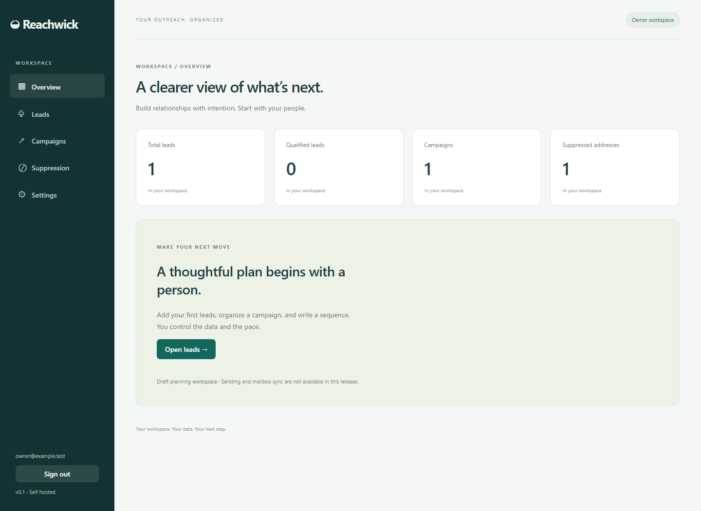

# Reachwick

**An open-source workspace for lead generation and outreach management. Your data. Your infrastructure.**

Manage leads, draft campaigns, sequences, schedules, and suppression lists in a self-hosted workspace. One owner, local SQLite storage, no required cloud services.

[Quick start](#quick-start) · [Docker & cloud](docs/deployment.md) · [Contribute](CONTRIBUTING.md) · [Roadmap](ROADMAP.md) · [Project board](https://github.com/users/Gerrard-Lewu/projects/4)



## Quick start

Requires Node.js 24 LTS and npm.

```sh
git clone https://github.com/Gerrard-Lewu/reachwick.git
cd reachwick
npm ci
npm run build
npm run owner:setup
npm start
```

Setup prompts for your email and password. Open [localhost:3000/app](http://127.0.0.1:3000/app). Start empty or load synthetic examples with `npm run seed`.

## Run it anywhere

Run on Windows, macOS, or Linux, or use Docker on a server you choose. The Cloudflare Tunnel example is optional; no cloud provider is required. See [installation](docs/installation.md), [deployment](docs/deployment.md), and [backup & recovery](docs/backup.md).

**v0.1.0 candidate:** manage leads from manual entry or CSV, organize campaigns, and plan sequences. Owner-focused lead discovery and research is the next milestone. Email delivery, mailbox sync, billing, and team accounts are later work. Container and hosted deployment checks remain [release gates](docs/release.md).

## Contribute

[Contribution guide](CONTRIBUTING.md) · [API](docs/api.md) · [Architecture](docs/architecture.md) · [Security](SECURITY.md)

Maintained by Gerrard Lewu. [MIT](LICENSE); dependencies retain their [licenses](THIRD_PARTY_NOTICES.md). Repository practices inspired by [REA](https://github.com/morluto/rea).
